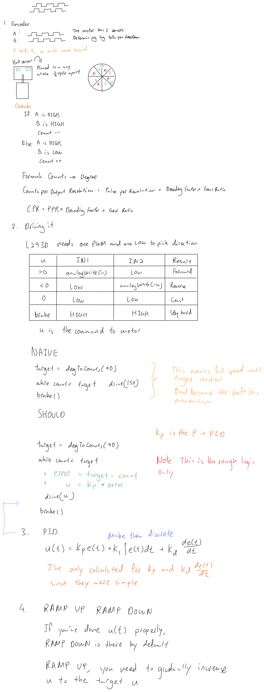

# Notes
[Interrupts](Interrupts.md)

Observing A, then B's edge.

Used in the calculations for CPR = PPR * Decoding Factor * Gear Ratio
If count++, then its moving forward. If count--, moving backward
count++ means A is leading. count-- means B is leading.

If I want to count the ticks at 4x resolution, then I must do the following:
```
FORWARD CASE
if A HIGH:
	B LOW
	count++
if B HIGH:
	A HIGH
	count++
if A LOW:
	B HIGH
	count++
if B LOW:
	A LOW
	count++
REVERSE CASE
if B HIGH:
	A LOW
	count--
if A HIGH:
	B HIGH
	count--
if B LOW:
	A HIGH
	count--
if A LOW:
	B LOW:
	count--
```


# Found Resources
https://docs.arduino.cc/language-reference/en/functions/external-interrupts/attachInterrupt/


